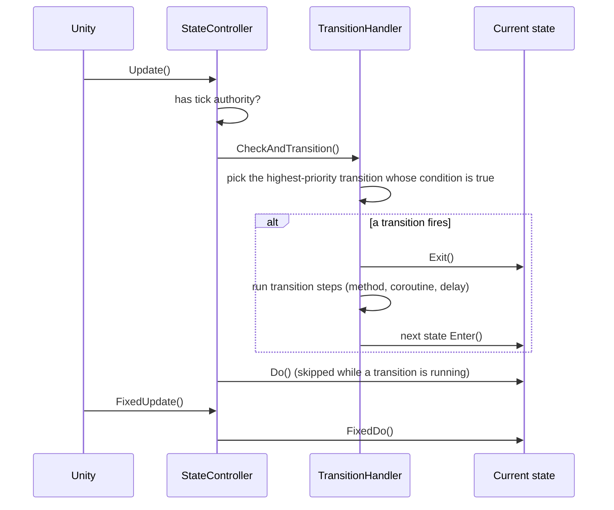

# Dragonveil State Machine

A small hierarchical state machine for Unity. It drives the player controllers in **Soul Heist**, an online multiplayer game in development, and grew out of a movement controller I first wrote in 2024.

- **States and super states.** A super state, such as Ground, owns its own sub-states (Idle → Walk → Run) and keeps the active one when it's left and re-entered.
- **Prioritised transitions.** Conditions are plain `bool` methods. The highest priority wins; ties keep registration order, so behaviour is deterministic.
- **Transition steps.** A transition can run a method, a coroutine and/or a delay before the next state enters. The old state stops ticking while it runs.
- **A tick-authority hook.** Override one property to decide who runs the machine. In Soul Heist, only the owning client ticks its player, and this package has no networking dependency.

## How it ticks



A super state runs the same loop one level down: its `Do()` checks its own transitions, then ticks the active sub-state.

## Usage

```csharp
using Dragonveil.StateMachine;
using UnityEngine;

public class PlayerController : StateController
{
    private State idle, run, jump;
    private Vector2 input;
    private bool jumpPressed;

    public override void InitialiseStates()
    {
        idle = new IdleState(this);
        run = new RunState(this);
        jump = new JumpState(this);
    }

    public override State AwakeState() => idle;

    public override void CreateTransitions()
    {
        CreateTwoWayTransition(idle, run, () => input.sqrMagnitude > 0f, () => input.sqrMagnitude == 0f);
        CreateTransition(idle, jump, () => jumpPressed, priority: 10);
        CreateTransition(run, jump, () => jumpPressed, priority: 10);
    }
}

public class IdleState : State
{
    private readonly PlayerController player;
    public IdleState(PlayerController player) => this.player = player;

    public override void Enter() { /* play idle animation */ }
    public override void Do() { }
    public override void FixedDo() { /* apply friction */ }
    public override void Exit() { }
}
```

A transition with a step, for example a 0.15 s dash wind-up, or a coroutine that runs every time the transition fires:

```csharp
CreateTransition(run, dash, () => dashPressed, transitionMethod: PlayDashWindUp, transitionTimeInSeconds: 0.15f);
CreateTransition(ground, ledgeHang, () => grabbedLedge, () => SnapToLedge());   // SnapToLedge() returns IEnumerator
```

A super state with its own sub-states:

```csharp
public class GroundState : SuperState
{
    private readonly State idle, run;

    public GroundState(PlayerController player) : base(player)
    {
        idle = new IdleState(player);
        run = new RunState(player);
        TransitionHandler.CreateTwoWayTransition(idle, run, () => player.IsMoving, () => !player.IsMoving);
        TransitionHandler.StateChanged += (from, to) => Debug.Log($"Ground: {from} → {to}");
    }

    protected override State AwakeSubState() => idle;
    protected override void SuperStateEnter() { /* snap to ground */ }
    protected override void SuperStateDo() { }
    protected override void SuperStateFixedDo() { /* apply gravity */ }
    protected override void SuperStateExit() { }
}
```

## Behaviour you can rely on

These rules are each covered by a PlayMode test.

- **Exit before enter.** The old state's `Exit()` runs before the next state's `Enter()`. Leaving a super state exits its sub-state first.
- **Deterministic picks.** The highest priority wins; equal priorities keep the order transitions were added in.
- **No ticking mid-transition.** While a transition's steps are running, `Do()` and `FixedDo()` are skipped.
- **Steps run every time.** A coroutine step is created fresh each time its transition fires.
- **Disabling cancels cleanly.** Disabling the controller mid-transition cancels the transition. The destination is never entered, and the state being left is entered again when the controller is re-enabled.
- **Sub-states enter before they leave.** Entering a super state always enters its sub-state before checking the sub-state's transitions.
- **Events stay at their level.** `StateController.StateChanged` reports top-level changes only. Each super state's `TransitionHandler.StateChanged` reports its own sub-state changes.

Gating the machine for networking, without depending on a networking package:

```csharp
public class NetworkedPlayerController : PlayerController
{
    // Only the owning client runs its own movement states.
    // IsNetworkSession and IsOwner come from your networking layer (Soul Heist uses Netcode for GameObjects).
    protected override bool CanTickStateMachine => !IsNetworkSession || IsOwner;
}
```

## Structure

```text
Runtime/
├── Core/
│   ├── State.cs             # Enter / Do / FixedDo / Exit
│   ├── SuperState.cs        # a state with its own sub-states and transitions
│   ├── StateController.cs   # MonoBehaviour that owns and ticks the machine
│   └── StateExtensions.cs   # GetActiveLeaf(), IsInCategory<TMarker>()
└── Transitions/
    ├── Transition.cs        # from → to, condition, priority, optional steps
    └── TransitionHandler.cs # picks and runs transitions
Tests/Runtime/               # 18 PlayMode tests (Unity Test Framework)
```

## Run the tests

Open the repository root in Unity 6000.3, then **Window → General → Test Runner → PlayMode → Run All**. Or from the command line:

```bash
Unity -batchmode -projectPath . -runTests -testPlatform PlayMode -testResults results.xml
```

## Rights

Copyright (c) 2024-2026 Ahmed Abdalla. All rights reserved. The code is public so it can be read and evaluated. It may not be copied or used in other projects without permission. See [LICENSE](../../LICENSE).
